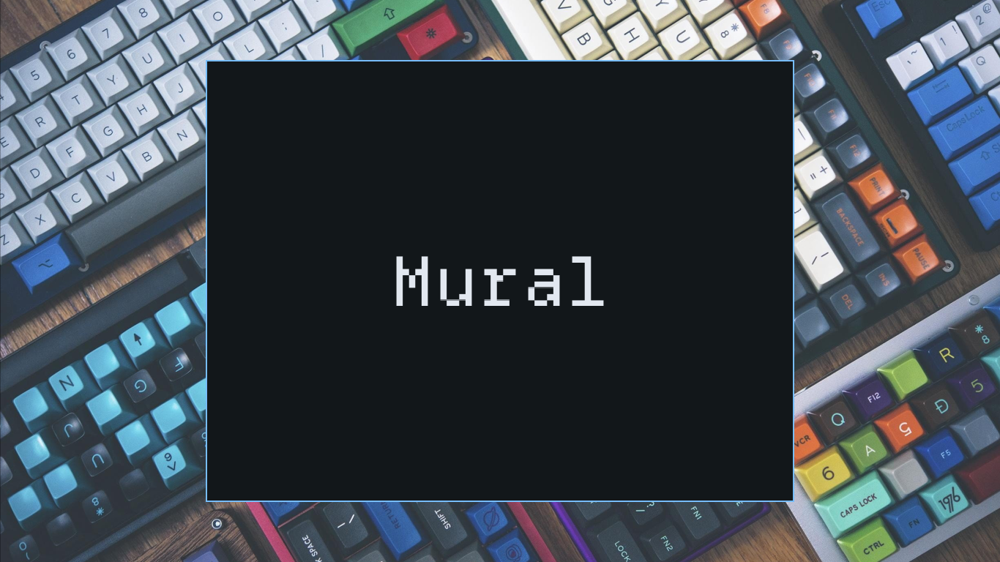
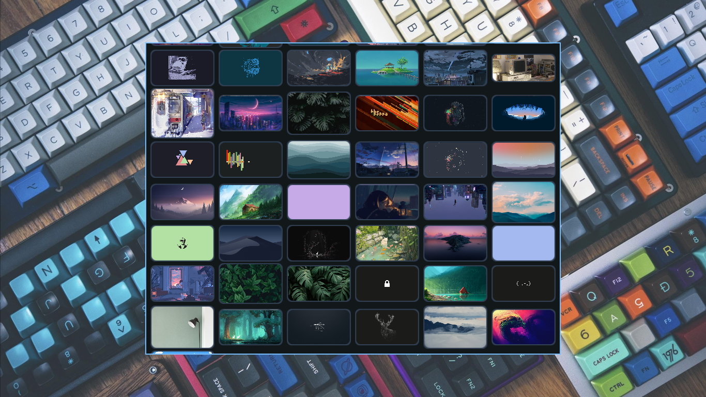

# Mural

Mural is a small wallpaper browser for Linux written in C.

It uses OpenGL for rendering and X11 for the desktop environment.

## Use

### Building
```bash
$ gcc -o cbuild cbuild.c
$ ./cbuild
```

### Running
```bash
$ ./mural
```

### Restore wallpaper
```bash
$ ./mural --restore
```

## Features

- Browse wallpapers in a thumbnail grid
- Variable thumbnail heights
- Smooth scrolling
- Background image loading
- OpenGL texture atlas
- Rounded thumbnails
- Configurable appearance
- Select a wallpaper with a click
- Restore the last selected wallpaper
- TOML configuration

## Requirements

- Linux
- X11
- OpenGL
- GLFW
- GLEW
- feh

## Configuration

Mural uses `mural.toml`.

```toml
[general]
scroll_speed = 30.0
font_file = "./font.otf"
font_size = 120.0

[layout]
thumbnail_width  = 120.0
thumbnail_radius = 10.0
margin           = 10.0
inner_gap        = 7.0
border_thickness = 2.0

[color]
background      = 0x12171aff
border_select   = 0x7dd3fcff
border_unselect = 0x334155ff
font_color      = 0xe2e8f0ff

[wallpapers]
paths = [
  "/home/user/Wallpapers"
]
selected_wallpaper = ""
```

## Screenshots


